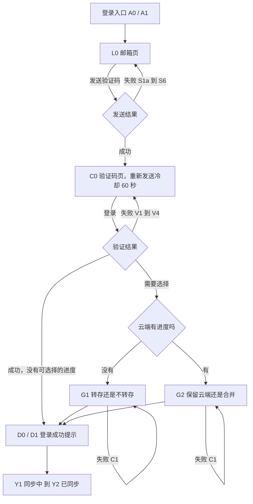
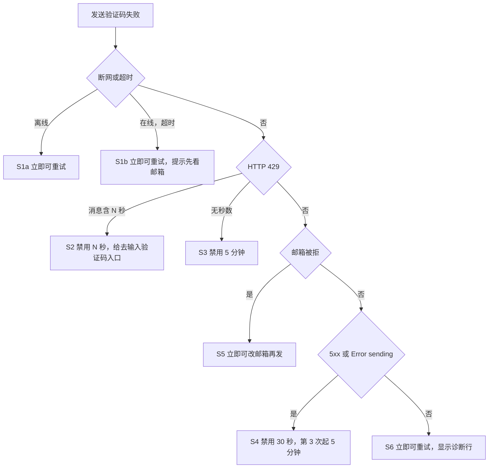
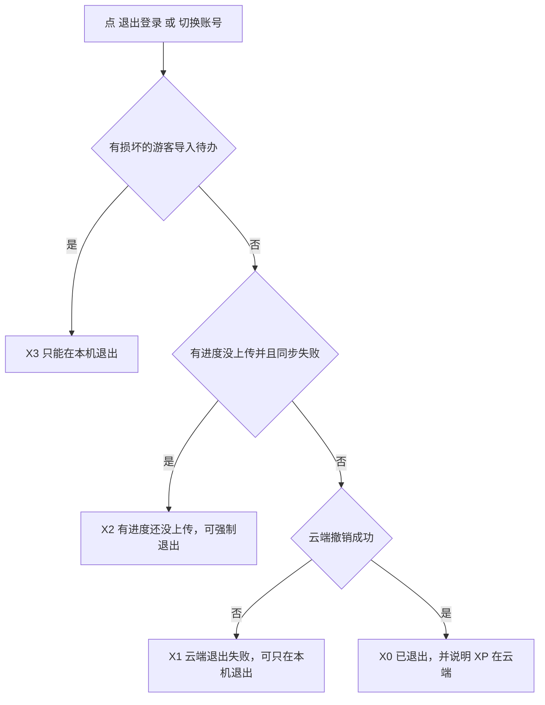

# 登录与同步体验设计规范（DESIGN-AUTH-02）

日期：2026-11-09　主责：设计师 Sonnet　下一棒：程序员 Sonnet　状态：待产品官验收
依据：`acc1/` 预览（构建于 2026-11-08 06:32 UTC）对应的源码提交 `d284d54`（`PREVIEW_INFO.json` 里的 sha）。
范围：只做设计和只读审查。没有改业务代码，没有部署，没有碰 Supabase。
引用的函数名和文案都来自 `d284d54` 的 `src/account-ui.js`、`src/sync.js`、`src/app.js`、`src/game.css`、`src/app.css`。

---

## 0. 一页结论

核心问题只有一个：**用户看到失败时，不知道自己的 XP 在哪。** acc1 现状有四个原因：

1. 登录和同步的失败提示里，凡是不在 `ERR` 三类（断网、限流、云端未开通）里的，都原样显示服务器返回的英文（`errorText` 的兜底是 `r.message`）。同步失败状态也是（`"同步失败：" + s.message`）。
2. 整个登录流程从头到尾没有一句话说"你的进度在这台设备上"。
3. 正常退出后，界面回到"游客记录"。合并过的用户，游客记录已被清空，会看到 0 XP，只有一句"已退出登录。"。
4. 键盘弹出时，错误提示放在按钮下面，在最小的 iPhone 上会被键盘挡住。

本规范的解法：

| 问题 | 规范 |
|---|---|
| 英文原文 | 所有失败按固定分类给中文。服务器原文永远不显示，只给一行"诊断：状态码 · 错误码"（§2.4） |
| 不知道 XP 在哪 | 游客 XP 大于 0 时，每个失败状态都带一行"你的 {xp} XP 还在这台设备上，没有丢。"（§2.1） |
| 退出后 0 XP | 退出提示必须说明账号进度在云端、重新登录就回来（§3.6） |
| 键盘挡住 | 错误块放在输入框下面；发送按钮吸底；键盘弹出时说明文字缩短（§5） |

问题分级见 §7，验收清单见 §6。

---

## 1. 设计原则

1. **先说发生了什么，再说进度在哪，最后说下一步做什么。** 三句话，缺一不可。
2. **进度行不用红色。** 红色只给"发生了什么"。进度行用灰色，避免红字把"丢了"的感觉带到 XP 上。
3. **不说"安全"，说"还在"。** 未登录的本机进度，在 Safari 标签页里一周左右不打开可能被系统清理（`docs/14` 第 7 条）。"还在"是现在的事实，"安全"像是永久承诺。
4. **服务器原文、邮箱地址、令牌、项目域名永远不出现在界面或截图里。**
5. **不靠颜色传达信息，不用 ✕、红心、感叹号。**
6. **每个状态写清四件事：按钮、什么时候禁用、用户下一步、本机数据在不在。**

占位符：`{xp}` 是游客当前 XP（`getState().xp`）。XP 为 0 时整行进度行不显示。`{N}` 是秒数。

---

## 2. 任务一：登录失败界面定稿

### 2.1 视觉层级

错误区是一个固定的元素，叫 `.login-feedback`，放在输入框正下方、主按钮上方。它自带 `role="alert"`，里面按顺序最多三层：

| 层 | 内容 | 字号 / 字重 | 颜色 | 何时出现 |
|---|---|---|---|---|
| L1 原因与动作 | 例如"没连上网络，验证码没发出去。联网后再点「发送验证码」。" | 15 px / 600，行高 1.6 | `--g-bad`（浅色约 5.9:1，深色用现有深色值） | 所有失败 |
| L2 进度行 | "你的 {xp} XP 还在这台设备上，没有丢。" | 14 px / 400 | `--g-muted`（浅色约 5:1） | 游客 XP > 0 时，所有失败 |
| L3 诊断行 | "诊断：500 · unexpected_failure" | 12 px，等宽 | `--g-muted` | 只有 S4、S5、S6、C1 的数据类失败 |

实现要点：

- 现有 `.login-msg { font-size: 14px }` 会被 `.lsheet p { font-size: 15px; line-height: 1.6 }` 盖掉（后者选择器更具体）。L2、L3 要用 `.lsheet .login-feedback p.xxx` 这样的选择器才能生效。
- 三层放在同一个 `role="alert"` 容器里，更新时整块替换文字，读屏会一次读完。容器本身始终存在，不要每次新建。
- 失败后焦点留在输入框，不要移动。
- "正在发送…"、"已重新发送。"这类非错误提示，只用 L2 的灰色样式，不用红色。

### 2.2 失败文案（定稿）

比第一版（上一轮回复）收紧了：L1 在 320 宽屏幕上不超过 2 行（约 38 个汉字），这样键盘弹出时也放得下。

| ID | 触发 | L1 文案 | 诊断行 |
|---|---|---|---|
| S1a 离线 | 请求失败，且 `navigator.onLine === false` | 没连上网络，验证码没发出去。联网后再点「发送验证码」。 | 不显示 |
| S1b 超时 | 请求失败但在线，或 15 秒超时 | 网络不稳，没等到回应。验证码可能已经发出，先看看邮箱（含垃圾邮件）。 | 不显示 |
| S2 刚发过 | 429，消息里有"N seconds" | 刚刚已经发过验证码，请等 {N} 秒再发。先看看邮箱（含垃圾邮件），验证码还能用。 | 不显示 |
| S3 邮件配额 | 429，消息里没有秒数 | 登录邮件发得太多，暂时发不出验证码。请过一会儿再试，最久可能要等一小时。 | 不显示 |
| S4 服务故障 | 5xx，或消息匹配 `Error sending … email` | 邮件服务暂时出问题，验证码没发出去。不是你的操作有误，过几分钟再试。 | 显示 |
| S5 邮箱无资格（正式） | 见 §2.5 分类 | 这个邮箱暂时收不到登录验证码。请换一个邮箱试试。 | 显示 |
| S5 邮箱无资格（测试入口） | 同上，且构建带 `PREVIEW_ID` | 这个邮箱不在测试名单里。测试入口只允许指定邮箱登录。 | 显示 |
| S6 其他 4xx | 以上都不是 | 验证码没发出去。请检查邮箱地址，或稍后再试。仍不行请截图下方诊断信息。 | 显示 |
| V1 验证码不对 | 验证接口返回 4xx | 沿用现有：验证码错误或已过期，请检查后重试，或点“重新发送”。 | 不显示 |
| V2 验证太频繁 | 验证接口 429 | 输入得太频繁了，请等 {N} 秒再试。 | 不显示 |
| V3 验证时网络不稳 | 验证接口断网或超时 | 网络不稳，登录没有确认。再点一次「登录」；如果提示验证码无效，点「重新发送」换新的。 | 不显示 |
| V4 验证时服务故障 | 验证接口 5xx | 登录服务暂时出问题，请等几分钟再点「登录」。 | 显示 |
| C1 选择步骤失败 | 转存、保留云端、合并时失败 | 没有处理完。你的游客进度原样留在这台设备上，可以再试一次。 | 数据类失败时显示 |

补充规则：

- S4 连续失败第 3 次起，L1 末尾追加一句：先继续学习，晚点再登录也行。
- 第一版里"S5 测试入口"和"S6"的文案偏长，已经缩短。
- 生产环境的 S5 不说"邮箱没注册"或"邮箱不存在"，避免暴露某个邮箱有没有账号。

### 2.3 冷却倒计时与重新发送

1. 发送成功，进入验证码页：`cooldownUntil = Date.now() + 60000`。「重新发送」禁用，按钮文字是"重新发送（{s} 秒）"。
2. 倒计时必须用 `cooldownUntil - Date.now()` 算，不能靠每秒累减。原因：用户要切到邮件 App 取验证码，iOS 会暂停后台页面的计时器。页面触发 `visibilitychange`（变为可见）时立刻重算并刷新按钮。
3. 倒计时到 0：按钮文字恢复成"重新发送"并启用；在状态区用礼貌模式播报一次"现在可以重新发送了"。焦点不动。
4. 点「重新发送」：按钮禁用，文字"发送中…"；成功后显示灰色"已重新发送。请查收邮件（含垃圾邮件）。"，重新计时 60 秒；失败按 §2.2 分类显示，冷却规则见下。
5. 服务端 429（S2）覆盖本地 60 秒：用服务端给的 `{N}`，解析不出就用 60。`{N}` ≤ 90 显示"{N} 秒"，更大显示"约 {m} 分钟"。
6. 冷却时的按钮文字：S2 是"{N} 秒后可再发"；S3 是"约 5 分钟后可再试"；S4 前两次是"30 秒后可再试"，从第 3 次起是"约 5 分钟后可再试"。
7. S2 出现时，在错误区下面加次按钮「我已收到，去输入验证码」，直接进入验证码页。
8. V1（验证码不对）不重置冷却。输入框保留已输入内容并全选，方便重新输入。
9. 「换个邮箱」始终可点，回到邮箱页并保留已输入的邮箱。
10. 验证码页连续点过 2 次「重新发送」后，追加一行灰字："还是没收到？确认邮箱 {email} 拼写正确，或点「换个邮箱」。"（P2）

冷却时长汇总（5 分钟和 30 秒是设计取值，试用后可调）：

| 状态 | 「发送验证码」 | 可再点 | 备注 |
|---|---|---|---|
| S1a | 不禁用 | 立即 | |
| S1b | 不禁用 | 立即 | 邮件已发出的话会进入 S2，文案会引导 |
| S2 | 禁用 | {N} 秒（默认 60） | 同时出现「我已收到，去输入验证码」 |
| S3 | 禁用 | 5 分钟 | |
| S4 | 禁用 | 前 2 次 30 秒；第 3 次起 5 分钟 | 成功一次即清零，计数只放内存 |
| S5 | 不禁用 | 立即 | 改邮箱就能再发 |
| S6 | 不禁用 | 立即 | |

### 2.4 错误码不泄露敏感信息

诊断行格式固定为：`诊断：{状态码或“断网”} · {错误码}`。

- 错误码只取服务器 `error_code` 字段，并且必须匹配 `^[a-z0-9_]{3,40}$`。不匹配、没有，就只显示状态码。
- **永远不能出现**：邮箱地址（Supabase 的原文常带邮箱）、令牌、项目域名或项目编号、请求体、响应体原文。
- 同样不要把整个响应对象输出到控制台或统计，因为里面有 `message` 和邮箱。
- 诊断行允许用户长按选中复制。
- 为什么不直接显示 `message`：S5 的服务器原文类似 `Email address "x@y" cannot be used`，会把邮箱写进截图。

### 2.5 分类规则（给程序员，按顺序匹配）

1. 请求失败（断网或超时）：按 `navigator.onLine` 分 S1a、S1b。目前请求层把断网和超时合成一种，需要把超时单独标出来（`AbortError`）。
2. HTTP 429：消息里匹配 `(\d+)\s*second` 就是 S2，否则 S3。错误码 `over_request_rate_limit` 按 S2、N=60 处理。
3. 错误码或消息像"邮箱不被允许"：候选有 `email_address_not_authorized`、`email_address_invalid`、`signup_disabled`、`otp_disabled`，或消息含 `not authorized`、`Signups not allowed`。归 S5。这是候选清单，不是确认过的清单。
4. HTTP ≥500，或消息匹配 `Error sending .* email`：S4。
5. 其他 4xx：S6。

前四条没命中的，一律落到 S4 或 S6，所以即使猜测有误，用户也不会看到英文。Supabase 官方文档没有写全这些状态码和错误码：每小时配额用完，常表现为 500 的 `Error sending … email`，不一定是 429。程序员需要在 acc1 测试库复现一遍，见 §6 的测组（测-1）。

---

## 3. 任务二：登录与同步状态

每行写清：界面文案、按钮、禁用条件、用户下一步、本机数据是否保留。"沿用"表示 `d284d54` 的现有文案不改。

### 3.1 登录入口与邮箱页

| ID | 状态与触发 | 界面文案 | 按钮与禁用条件 | 用户下一步 | 本机数据 |
|---|---|---|---|---|---|
| A0 | 游客，"我的"页账号卡片 | 沿用：登录后，进度会保存到云端，换手机或 iPad 也能接着学。 | 「邮箱登录 / 注册」，始终可点 | 点开登录 | 保留，没有改动 |
| A1 | 游客，地图页一行入口 | 沿用：登录 / 注册：换设备也能接着学 | 整行可点 | 点开登录 | 保留 |
| L0 | 邮箱页，键盘未弹出，游客 XP > 0 | 标题：登录 / 注册。说明：你现在的 {xp} XP 保存在这台设备上。登录后会多存一份到云端，换手机或 iPad 也能接着学。没有账号会自动创建；不用设密码。（调用方传了 `reason` 时保留 `reason`，再单独加一行进度行） | 「发送验证码」，邮箱格式不对时仍可点，点后提示；「先不登录」始终可点 | 输入邮箱，发送 | 保留 |
| L0k | 邮箱页，键盘已弹出 | 说明缩成一行：你的 {xp} XP 保存在这台设备上。不用设密码。有错误提示时说明整段隐藏，只留错误区 | 同上 | 同上 | 保留 |
| L0e | 邮箱格式不对 | 沿用：请输入有效的邮箱地址。（L1，不带进度行） | 不禁用 | 改邮箱 | 保留 |
| L1 | 发送中 | 灰字：正在发送… | 「发送验证码」禁用，文字"发送中…"，结束后恢复 | 等待，不超过 15 秒 | 保留 |
| S1a 到 S6 | 发送失败 | 见 §2.2 | 见 §2.3 | 见 §2.2 | 保留，没有改动 |
| LC | 本机残留的登录凭证（`hasLeftoverAuth`） | 沿用按钮：清理本机残留的登录凭证 | 清理中禁用，读回确认后才提示成功 | 清理后继续登录 | 学习记录保留 |

### 3.2 验证码页与首次登录成功

| ID | 状态与触发 | 界面文案 | 按钮与禁用条件 | 用户下一步 | 本机数据 |
|---|---|---|---|---|---|
| C0 | 发送成功 | 标题：输入验证码。沿用：验证码已发到 {email}。没收到？看看垃圾邮件，或稍等再重新发送。（邮箱地址长时要能换行：`overflow-wrap: anywhere`） | 「登录」，验证码少于 4 位时点后提示；「重新发送」冷却中禁用；「换个邮箱」始终可点 | 去邮箱取码，回来输入 | 保留 |
| C0b | 验证码少于 4 位 | 沿用：请输入邮件里的验证码。 | 不禁用 | 补全 | 保留 |
| V0 | 验证中 | 灰字：正在登录… | 「登录」禁用，文字"登录中…" | 等待 | 保留 |
| V1 到 V4 | 验证失败 | 见 §2.2 | 「登录」恢复可点 | 重输或重新发送 | 保留，没有改动 |
| D0 | 登录成功，没有游客进度也没有云端进度 | 提示：登录成功，进度已同步。 | 弹窗关闭 | 开始学习 | 无需处理 |
| D1 | 登录成功，但这次没能同步 | 提示（不再拼接服务器原文）：登录成功。云端这次没同步上，联网后会自动补上，你的进度在这台设备上。 | 弹窗关闭 | 继续学习，等自动同步 | 保留 |

D1 是对现有 `success()` 的修改：现在它会拼出"云端暂时没同步上（{服务器原文，可能是英文}）"。

### 3.3 游客进度合并与保留云端

| ID | 状态与触发 | 界面文案 | 按钮与禁用条件 | 用户下一步 | 本机数据 |
|---|---|---|---|---|---|
| G1 | 云端没有进度，设备上有游客进度 | 标题：转存这台设备上的进度？说明沿用：这台设备上有没登录时学的进度（{xp} XP、{n} 关）。要放进这个账号吗？小字沿用（安全合并的规则）。 | 「安全合并到账号」（主），「不转存，用全新账号」 | 二选一 | 选合并：上传并读回一致后才清除游客记录；选不转存：游客记录原样保留 |
| G2 | 云端已有进度，设备上也有游客进度 | 标题：这个账号已有学习进度。说明沿用。 | 「保留云端进度（推荐）」（主），「安全合并游客进度」 | 二选一 | 选保留云端：游客记录原样保留，只记指纹；选合并：同 G1 |
| G3 | 选择处理中 | 灰字：正在上传并核对… | 两个按钮都禁用；点遮罩和按 Esc 不关闭弹窗 | 等待 | 保留，失败不丢 |
| C1 | 选择失败 | 见 §2.2 | 两个按钮恢复可点 | 再试一次 | 游客进度原样保留 |
| G4 | 用户想关掉选择弹窗（点遮罩或 Esc） | 提示：已取消登录。你的 {xp} XP 还在这台设备上。 | 无 | 重新登录 | 保留。**需程序员确认**：关闭后登录是否真的撤销、验证码已被消耗的会话是否要清掉 |

G3、G4 是新增。现状里选择弹窗没有"稍后再说"，点遮罩会直接关掉，登录处于半完成状态。

### 3.4 同步状态

同步状态显示在账号卡片和地图入口，沿用现有 `statusText`；改动的行标"改"。

| ID | 状态值 | 界面文案 | 按钮与禁用条件 | 用户下一步 | 本机数据 |
|---|---|---|---|---|---|
| Y0 | 无状态 | 沿用：已登录，正在准备同步… | 「立即同步」可点 | 等待 | 保留 |
| Y1 | syncing | 沿用：同步中… | 「立即同步」禁用，文字"同步中…" | 等待 | 保留 |
| Y2 | synced | 沿用：已同步 ✓ | 「立即同步」可点 | 无 | 本机副本和云端一致 |
| Y3a | error，断网 | 改为离线状态 Y4，不再显示"同步失败" | 同 Y4 | 联网 | 保留 |
| Y3b | error，429 | 改：云端请求太频繁，稍后会自动重试。（现在显示"同步失败：发送太频繁了，请等一分钟再试。"，那是发验证码的文案） | 「立即同步」禁用并倒计时 | 等待 | 保留 |
| Y3c | error，5xx 或未知 | 改：云端暂时出问题，稍后会自动重试。进度还在这台设备上。诊断：{状态码} · {错误码} | 「立即同步」可点 | 稍后再试 | 保留 |
| Y3d | error，数据类（`kind: "data"`） | 改：云端的进度记录读不出来，同步已暂停。你的进度没有动，请截图下面的诊断信息发给我们。诊断：… | 「立即同步」可点；「导出进度文件」始终显示 | 导出备份并反馈 | 保留 |
| Y4 | offline | 沿用：现在离线：进度已存在这台设备，联网后自动同步 | 「立即同步」可点，失败仍提示离线 | 联网即可 | 保留 |
| Y5 | 恢复联网 | 离线 → 同步中… → 已同步 ✓。成功时不弹提示，只换状态文字 | 无 | 无 | 保留，上传后与云端一致 |
| Y6 | pending | 沿用：有进度等待上传（联网后自动同步） | 「立即同步」可点 | 等待 | 保留，未上传的部分带标记 |
| Y7 | need-login | 沿用：登录已过期，需要重新登录才能同步（进度还在这台设备上） | **新增主按钮「重新登录」**，打开登录页，邮箱预填，`reason` 为"登录已过期，重新登录后会接着上传。" | 重新登录 | 保留，同一个账号重新登录会接着上传 |

Y7 现状没有"重新登录"按钮。用户要先点"退出登录"或"切换账号"，还会撞上 §3.6 的退出提示。

### 3.5 本机写回失败、冲突、待办恢复

| ID | 状态与触发 | 界面文案 | 按钮与禁用条件 | 用户下一步 | 本机数据 |
|---|---|---|---|---|---|
| Y8a | 云端已保存，本机写回失败 | 改：进度已经存到云端，但这台设备没能更新本机副本。原来的本机进度还在，会自动重试。 | 「立即同步」可点 | 等自动重试 | 原有副本保留 |
| Y8b | 本机写回失败，云端也没确认 | 改：这台设备暂时存不下新进度。原来的进度还在，会自动重试。请确认手机存储空间没满。 | 「立即同步」可点；「导出进度文件」显示 | 检查存储空间 | 原有副本保留；新学的进度可能也存不下，要如实说 |
| Y8c | 写回连续失败 3 次，自动同步已暂停 | 改：这台设备连续 3 次存不下同步结果，已暂停自动同步。原来的进度还在这台设备上。请检查存储空间或浏览器权限，再点「立即同步」。 | 「立即同步」可点；「导出进度文件」显示 | 检查后手动同步 | 原有副本保留 |
| Y8d | 重试计数无法确认或无法清零 | 沿用现有两条文案，末尾统一改成"…再点「立即同步」" | 同 Y8c | 同 Y8c | 保留 |
| Y9a | conflict，**没有新逻辑时的最小方案** | 这个账号在别处被覆盖过，同步已暂停。你在这台设备上的进度还在，可以继续学习。请先导出进度文件备份，再联系我们处理。 | 「导出进度文件」（主）；「立即同步」禁用并说明原因 | 导出备份，反馈 | 保留 |
| Y9b | conflict，**有新逻辑时的目标方案** | 标题：这个账号有两份不同的进度。两张对比卡：这台设备（{xp} XP、{n} 关、最近学习日期），云端（同样三项）。说明：两份不会合并，XP 也不会相加。选一份留下，另一份会先备份。 | 「用这台设备的」「用云端的」（各需二次确认）；「先不处理」（同步暂停，继续学习） | 选一份 | 被替换的那份必须先备份并读回确认，再覆盖 |
| Y10 | import-recovery-required | 沿用：游客导入记录损坏：云端同步已暂停。学习进度仍保存在本机，请保留数据等待恢复处理。 | 「备份并重新导入」，点后确认弹窗（沿用文案） | 确认后备份，重新选择游客进度怎么处理 | 游客记录、账号副本、登录都不会被删 |
| Y10b | 恢复成功 | 沿用：损坏的待办已备份并移除。随后进入 G1 或 G2 | 无 | 重新选择 | 备份读回确认后才移除原待办 |
| Y10c | 恢复中途失败 | 沿用：没有处理成功，原来的待办还在。（Y10 后半段的"还没能确认云端"，其中的失败原因改用 §2 的分类文案） | 「立即同步」可点 | 再试 | 保留，原待办还在 |
| Y11 | import-read-failed | 沿用：无法读取游客导入记录：云端同步已暂停。请检查本机存储后重试。 | 「重试读取」，点后禁用到结果返回 | 检查存储，重试 | 只读取失败，不会备份或删除任何东西 |
| Y12 | pending-local-cleanup | 沿用：账号已在云端删除，但这台设备还没清理完。请不要继续用这个登录。 | 新增「完成清理」（具体入口由程序员确认，设计要求必须有明确的按钮） | 完成清理 | 学习记录保留 |

Y9a 的"联系我们"需要产品官决定联系方式，规范里不写死。Y9b 需要新的业务逻辑和数据模型确认，见 §7 的 P1-1。

### 3.6 退出

流程见 §4.3。

| ID | 状态与触发 | 界面文案 | 按钮与禁用条件 | 用户下一步 | 本机数据 |
|---|---|---|---|---|---|
| X0 | 普通退出成功 | 改：已退出登录。账号里的 {xp} XP 在云端，重新登录就回来。（{xp} 取退出前账号的 XP） | 提示 6 秒后消失 | 需要时重新登录 | 账号的本机副本在确认已上传后清除；界面回到游客记录，XP 可能是 0，所以必须这样说 |
| X1 | 云端退出失败（`stayed`） | 标题沿用：云端退出失败。说明改：这台设备仍保持登录。已同步的进度在云端；没同步的留在这台设备上，用同一个账号重新登录会接着上传，XP 会回来。可以稍后再试，或只在这台设备退出（云端会话可能仍有效）。 | 「只在这台设备退出」（危险样式），「取消」 | 稍后重试，或本机退出 | 未上传的进度保留 |
| X2 | 有进度还没上传（`pending`） | 沿用标题：有进度还没上传。说明沿用，末尾加：重新登录后 XP 会回来。 | 「仍然退出」（危险样式），「取消」 | 联网后再退出更好 | 未上传的进度保留，同一个账号重新登录会接着上传 |
| X3 | 损坏的游客导入待办 | 沿用：游客导入待办需要恢复 | 「仅在本机退出」（危险样式），「取消」 | 先恢复，或本机退出 | 游客记录、损坏待办、未上传副本都保留；重新登录后仍需专门恢复 |
| X4 | 强制退出成功 | 沿用现有 `message`，末尾统一加：重新登录后 XP 会回来。 | 提示 6 秒后消失 | 需要时重新登录 | 保留 |
| X5 | `kind: "local"` 的退出失败（无法确认本机副本状态，或回滚） | 改：暂未退出。没能确认这台设备上的进度状态，你的进度没有动。请稍后再试。 | 只有「知道了」，**不给强制退出** | 稍后再试 | 保留。现状把它当成"有进度没上传"来提示（X2 的文案），不准确 |
| X6 | 回滚失败（`rollbackFailed`） | 改：退出没有完成，而且没能恢复原状。请不要清除浏览器数据，并截图下面的诊断信息发给我们。诊断：… | 「知道了」 | 反馈 | 能保留的都保留，状态可能不一致，要如实说 |
| X7 | 退出时残留登录凭证（`local-auth-leftover`） | 改短：已退出。云端已撤销登录，但这台设备上还残留一份登录凭证，要到 {hh:mm} 才失效。登录页里有「清理本机残留的登录凭证」。 | 提示至少 8 秒 | 按需清理 | 学习记录保留 |

---

## 4. 关键交互流程

### 4.1 登录主流程

### 4.2 发送失败的分类与重试

### 4.3 退出

### 4.4 取验证码要离开 App 再回来

用户必须切到邮件 App 取码，iOS 可能在后台回收页面，尤其是主屏幕模式。

1. 切走前：邮箱页和验证码页的状态（邮箱、发送时间、步骤）只放内存，不写本机存储（不存验证码）。
2. 回来时页面还在：`visibilitychange` 重算倒计时，状态不变。
3. 回来时页面被回收重载：回到地图，登录弹窗没了。这是 P1（§7），目标是在发送后 10 分钟内，重新点登录会回到"验证码页"，并提示"上次发到 {email}，输入验证码，或换个邮箱"。是否持久化邮箱和发送时间要产品官决定，因为邮箱会写进本机存储。
4. iOS 的验证码自动填充：输入框已有 `autocomplete="one-time-code"`，要在真机上确认键盘上方会出现"来自邮件的验证码"。

---

## 5. 任务三：移动端布局规范

### 5.1 现状与规范

现状（`d284d54`）：

- `.overlay` 是 `position: fixed; inset: 0`，底部对齐。`.sheet` 的 `max-height: 88%`，登录弹窗是 `92dvh` 并内部滚动。
- 弹窗的元素顺序是：标题、说明、输入、发送按钮、错误提示、先不登录。
- 应用已经有 `--app-h`（等于 `visualViewport.height`），但只用在 `.overlay.full` 和 `#app` 上，登录弹窗没用。
- `index.html` 的 viewport 带 `interactive-widget=resizes-content`。这个属性 iOS Safari 不一定认，不能当作它会缩小布局视口。

规范：

1. 元素顺序改成：标题、说明、输入、**错误区 `.login-feedback`**、**发送按钮（吸底）**、先不登录。
2. 发送按钮吸底：外面包一个 `position: sticky; bottom: 0`、背景用 `--g-bg` 的容器，上下各留 8 px。弹窗内容超高时，错误区在它上面滚动，按钮始终看得见。
3. 登录弹窗的高度上限用 `--app-h`：`max-height: calc(var(--app-h, 100dvh) - 8px)`，并让 `.overlay.login-sheet` 的高度也跟 `--app-h`，让弹窗底边贴在键盘上沿，而不是被键盘盖住。
4. 键盘弹出的判断：`visualViewport.height < window.innerHeight * 0.75`。此时给弹窗加 `kb-open` 类：说明文字缩成一行（L0k）；有错误时说明整段隐藏。
5. 错误区更新后调用 `scrollIntoView({ block: "nearest" })`，保证 L1 和 L2 可见。
6. 点遮罩关闭：保留 800 ms 防误触；处理中（L1、V0、G3）不允许关闭。
7. 触控目标：所有按钮高度 ≥ 52 px（现有 `.btn3d` 已满足），两个按钮之间至少 8 px。
8. 一行 L1 文字不超过 38 个汉字，在 320 宽上是 2 行。

### 5.2 实测（模拟）

方法：把 `d284d54` 的 `style.css`、`app.css`、`game.css` 搬进一个临时页面，在 Chromium 里把视口高度缩成"屏高减键盘高"。键盘高度取常见值：320×568 约 253，375×667 约 260，393×852 约 291，430×932 约 301，真机要用 `visualViewport.height` 读出来替换。

**这是乐观模型**：iOS Safari 弹出键盘时不缩小布局视口，`position: fixed` 的弹窗底边会被键盘盖住，真机只会比下面的数字更差。所以下面的"全部可见"也要在真机上确认（§6 机组）。

| 屏幕 | 键盘 | 现状（错误在按钮下面，说明常驻） | 规范（错误在输入下面，按钮吸底，说明缩短） |
|---|---|---|---|
| 320×568 | 关 | 弹窗 464 px，全部可见 | 约 470 px，全部可见 |
| 320×568 | 开（可视 315） | 弹窗被 92dvh 限制到 290 px 并内部滚动：**错误提示看不到**，发送按钮只露一部分，先不登录看不到 | 错误块 84 px（2 行红字加进度行）完整可见，发送按钮吸底可见，先不登录要滚动。带诊断行的 3 行红字错误块 147 px，诊断行要滚动才能看到 |
| 375×667 | 开（可视 407） | 全部可见，先不登录露一部分 | 错误块 84 或 123 px 都完整可见，发送按钮可见，先不登录要滚动 |
| 393×852 | 开（可视 561） | 弹窗 416 px，不滚动，全部可见 | 约 398 px，全部可见 |
| 430×932 | 开（可视 631） | 同上 | 同上 |

局限：模拟用的是 Linux 上的 Chromium，汉字用的是回退字体，不是 iPhone 的苹方，实际每行字数和换行位置可能差一两个字，也就是最多多一行。

### 5.3 主屏幕（PWA）模式

`manifest` 是 `display: standalone`，`apple-mobile-web-app-status-bar-style` 是 `default`。**以下全部没有在真机验证**，要在真机检查：

- 没有地址栏和底部工具栏，只有键盘和 Home 指示条。弹窗底部要避开 Home 指示条（现有 `env(safe-area-inset-bottom)` 已处理，需确认数值）。
- 顶部状态栏不透明时，`env(safe-area-inset-top)` 可能是 0。要确认弹窗顶部离状态栏至少 8 px。
- 切到邮件 App 取码再回来（§4.4）：页面是否被回收，倒计时是否正确，输入的邮箱是否还在。
- Safari 和主屏幕 App 的本机存储互相独立（`docs/14` 第 6 条）：用户在 Safari 里学了 50 XP，再添加到主屏幕，打开后看到 0 XP。这不是登录流程的问题，但会让人以为 XP 丢了，建议在"添加到主屏幕"的引导里说明，列为 P2。
- 没有下拉刷新。"页面没有正常加载"的兜底提示要在这里能看到。

---

## 6. 验收清单

### 测组：自动测试（程序员，用假服务器，不碰真实 Supabase）

| ID | 检查 | 预期 |
|---|---|---|
| 测-1 | 发送接口分别返回：断网、超时、429 带秒数、429 不带秒数、500 `Error sending magic link email`、503、400 `email_address_not_authorized`、422 `signup_disabled`、其他 4xx | 分别得到 S1a、S1b、S2、S3、S4、S4、S5、S5、S6；界面文字里没有英文字母（诊断行除外） |
| 测-2 | 验证接口分别返回：400、429、500、断网 | V1、V2、V4、V3 |
| 测-3 | 同步接口返回：断网、429、500、数据类错误 | Y4、Y3b、Y3c、Y3d；没有"同步失败：英文" |
| 测-4 | 游客 XP 为 50，走完 A1 到 A3 全部失败 | `suipian.progress` 的 `xp` 仍是 50；每个失败界面都有进度行，且不是红色 |
| 测-5 | 游客 XP 为 0 | 所有失败界面都没有进度行 |
| 测-6 | 响应消息里带邮箱地址 | 页面文字、`console` 输出里都找不到这个邮箱（验证码页自己显示的 `{email}` 除外） |
| 测-7 | 诊断行 | 只出现在 S4、S5、S6、V4、C1 数据类、Y3c、Y3d、X6；格式符合 §2.4；错误码不合法时只显示状态码 |
| 测-8 | 倒计时 | 用时间戳计算；`visibilitychange` 后立刻重算；归零后按钮恢复 |
| 测-9 | 选择弹窗处理中 | 两个按钮禁用，点遮罩和 Esc 不关闭 |
| 测-10 | 正常退出成功 | 提示里有账号 XP；界面回到游客记录 |
| 测-11 | `kind: "local"` 的退出失败 | 显示 X5，没有"仍然退出"按钮 |
| 测-12 | need-login | 账号卡片有「重新登录」，打开登录页时邮箱已预填 |

### 机组：iPhone 真机（Safari 和主屏幕模式各一遍）

| ID | 检查 | 预期 |
|---|---|---|
| 机-1 | 320×568（iPhone SE 第一代，没有的话用 375×667 并记录），邮箱页点输入框，键盘弹出 | 标题、输入框、发送按钮同时可见 |
| 机-2 | 同上，用飞行模式点发送 | L1 和进度行 2 到 3 秒内完整可见，发送按钮没被挡住 |
| 机-3 | 375、393、430 宽各做一遍 B2 | 同上 |
| 机-4 | 在 B2 状态下读出 `visualViewport.height` | 记下数值，替换 §5.2 的键盘高度 |
| 机-5 | 验证码页输入验证码，滑动弹窗 | 滚动流畅，没有页面整体跳动，没有弹窗被推出屏幕 |
| 机-6 | 切到邮件 App 取码，40 秒后切回 | 倒计时按真实时间显示，邮箱还在 |
| 机-7 | 重复 B6，但在后台停留 3 分钟以上 | 记录页面是否被回收；被回收时弹窗状态怎样 |
| 机-8 | 键盘上方是否出现"来自邮件的验证码" | 记录是或否 |
| 机-9 | 主屏幕模式下重复 B1 到 B7 | 弹窗顶部不被状态栏压住，底部不被 Home 指示条压住 |
| 机-10 | 浅色和深色各看一次错误区 | L1、L2、L3 都清楚，红字对比度够 |
| 机-11 | 开启"减弱动态效果" | 倒计时和弹出没有动画 |
| 机-12 | 读屏（VoiceOver）依次读错误区 | 一次读完 L1、L2、L3，不重复，不抢焦点 |
| 机-13 | 退出登录后看界面 | 提示里说清 XP 在云端；界面上的 XP 变化有解释 |
| 机-14 | 主屏幕模式关闭 App 再打开 | 本机进度还在 |

### 查组：设计走查（设计师或产品官）

| ID | 检查 |
|---|---|
| 查-1 | 随机抽 3 个失败界面，请一个不熟悉的人读，问"你的 XP 现在在哪"，他能答出"还在这台手机上" |
| 查-2 | 所有失败文案没有"失败"以外的感叹语气、没有 ✕ 和红心 |
| 查-3 | 红字只出现在 L1，进度行始终是灰色 |
| 查-4 | 所有按钮都有文字，没有只用图标的 |
| 查-5 | 320 宽下，L1 不超过 2 行 |
| 查-6 | "安全"一词没有出现在任何失败文案里 |

---

## 7. 问题分级

P0：测试版发给别人之前必须修，否则会让人以为进度丢了，或者无法完成登录和退出。
P1：应在下一轮修，会造成死路或明显困惑，但数据没有丢。
P2：体验优化，可以排期。

### P0

| ID | 问题 | 现状证据 | 对应规范 |
|---|---|---|---|
| P0-1 | 登录失败显示服务器英文原文，也没有说进度在哪 | `errorText` 兜底为 `r.message`；`ERR` 只有三类 | §2 |
| P0-2 | 同步失败和登录成功提示里也有英文原文 | `statusText` 的 `"同步失败：" + s.message`；`success()` 拼接 `syncError`；限流还会显示发验证码的文案 | §3.2 D1、§3.4 Y3 |
| P0-3 | 键盘弹出时错误提示和发送按钮可能被挡住 | 模拟：320×568 现状错误提示看不到；真机未验证，若真机已正常可降为 P1 | §5 |
| P0-4 | 正常退出后界面回到游客记录，合并过的用户会看到 0 XP，提示只有一句"已退出登录。" | `logoutLocal` 清除账号副本，`onSwitchedOut` 读游客记录；合并成功后游客记录已清除（依据界面文案和代码，未在浏览器里复现） | §3.6 X0、X1、X2、X4 |

### P1

| ID | 问题 | 现状证据 | 对应规范 |
|---|---|---|---|
| P1-1 | `conflict` 状态没有任何界面，是死路 | 状态文字说"需要选择保留哪一份"，但账号卡片只有立即同步、退出、切换账号、删除账号；`sync` 没有解决冲突的函数。需要新业务逻辑和数据模型确认 | §3.5 Y9a、Y9b |
| P1-2 | 登录过期后没有"重新登录"按钮 | `accountRow` 和 `accountCard` 在已登录时都没有登录入口 | §3.4 Y7 |
| P1-3 | 选择弹窗没有取消按钮，点遮罩会让登录处于半完成状态 | `stepChoice` 里没有"稍后再说" | §3.3 G3、G4 |
| P1-4 | 退出失败的 `kind: "local"` 被当成"有进度没上传"提示 | `doLogout` 里 `r.pending` 分支不区分 | §3.6 X5 |
| P1-5 | 取验证码要离开 App，页面被回收后登录状态丢失 | 邮箱和冷却只在内存 | §4.4 |
| P1-6 | 倒计时靠定时器，后台被暂停后不准 | `setInterval` 每秒刷新，但值本身是时间戳，需确认回到前台时有没有立即重算 | §2.3 第 2 条 |
| P1-7 | 超时和断网合并成一种，超时后邮件可能已发出，用户马上重发会撞限流 | `req` 里 `AbortError` 和 `fetch` 失败都返回 `network` | §2.2 S1b、§2.5 |

### P2

| ID | 问题 | 对应规范 |
|---|---|---|
| P2-1 | 客户端冷却不分邮箱，换邮箱也被 60 秒挡住 | §2.3 |
| P2-2 | 验证码页连续重发后没有"检查邮箱拼写"的提示 | §2.3 第 10 条 |
| P2-3 | `.lsheet p` 选择器盖掉了 `.login-msg` 的字号 | §2.1 |
| P2-4 | 很长的邮箱地址在验证码页可能撑破布局 | §3.2 C0 |
| P2-5 | 主屏幕 App 和 Safari 本机存储互相独立，换入口会看到 0 XP | §5.3 |
| P2-6 | 退出残留凭证的提示太长，6 秒读不完 | §3.6 X7 |
| P2-7 | "安全"一词的使用：产品官的任务描述里写的是"安全保存"，本规范改用"还在"，原因见 §1 第 3 条，需要产品官确认 | §1 |

---

## 8. 实现边界

纯文案和样式（程序员可以直接照做）：§2.2 的文案和 §2.1 的样式、§3 中标"沿用"和"改"的文案、§5.1 的元素顺序、吸底按钮、`kb-open` 类、`--app-h` 的使用。

需要少量逻辑：§2.5 的分类函数，超时标记，429 秒数解析，诊断行的错误码白名单，冷却的时间戳计算和 `visibilitychange` 重算，S4 的连续失败计数，D1 提示的映射，X0 提示里取退出前的账号 XP，Y7 的"重新登录"入口，G3 的处理中禁用和禁止关闭。

需要产品官或 GPT 先决定，再开发：Y9b 冲突选择界面及备份逻辑，G4 取消登录后的会话处理，§4.4 是否在本机存邮箱和发送时间，Y12 的清理入口，Y9a 的"联系我们"方式。

**没有验证的部分**：真机上的键盘行为、主屏幕模式、苹方字体的换行、自动填充验证码，以及 Supabase 在 acc1 测试库里对每种失败返回的真实状态码和错误码，都没有验证。

**没有覆盖的部分**：删除账号流程、导入进度文件、地图页的其他提示。
